<a href="https://ishaanranjan.com">
  <picture>
    <source media="(prefers-color-scheme: dark)" srcset="./assets/banner-dark.svg">
    
  </picture>
</a>

I study CS at Georgia Tech and do research under the [CyFI Lab](https://cyfi.ece.gatech.edu/). Right now that's NVIDIA's Nemotron Elastic, where one set of weights holds three models, and working out which smaller cuts of it are worth running. I also co-founded [Luxen AI](https://luxenai.org).

### Worth a look

- **[slm-agents](https://github.com/IshaanAyaan/slm-agents).** A 3B model fine-tuned for one narrow role, with a harness built around it, hit 94.5% on 200 held-out code-navigation tasks. A 72B baseline hit 95.5%. Ours cost 84.8% less per solved task. With Ganesh Talluri.
- **[Arbor](https://github.com/LuxenAI/arbor).** A desktop workspace for running live multi-agent coding sessions. It passed 1,250 users after its January 2026 release.
- **[Regimen](https://github.com/LuxenAI/regimen).** Splits a long task into parts and hands each one to a specialized small model.
- **[YConstruction](https://github.com/IshaanAyaan/YConstruction).** Report a construction defect by talking to your iPhone. Whisper and Gemma 3n run on the phone. It got picked to pitch live to YC investors.
- **[PRISM](https://github.com/IshaanAyaan/prism-policy-dashboard).** An atlas of what state alcohol-policy changes did, across 50 states and DC from 2000 to 2022. There's a [dashboard](https://prism-policy-dashboard.vercel.app) and an [SSRN paper](https://doi.org/10.2139/ssrn.6756239).

More at [ishaanranjan.com](https://ishaanranjan.com), and I'm on [X](https://x.com/ishaanranjan15) and [LessWrong](https://www.lesswrong.com/users/ishaan-ranjan).
